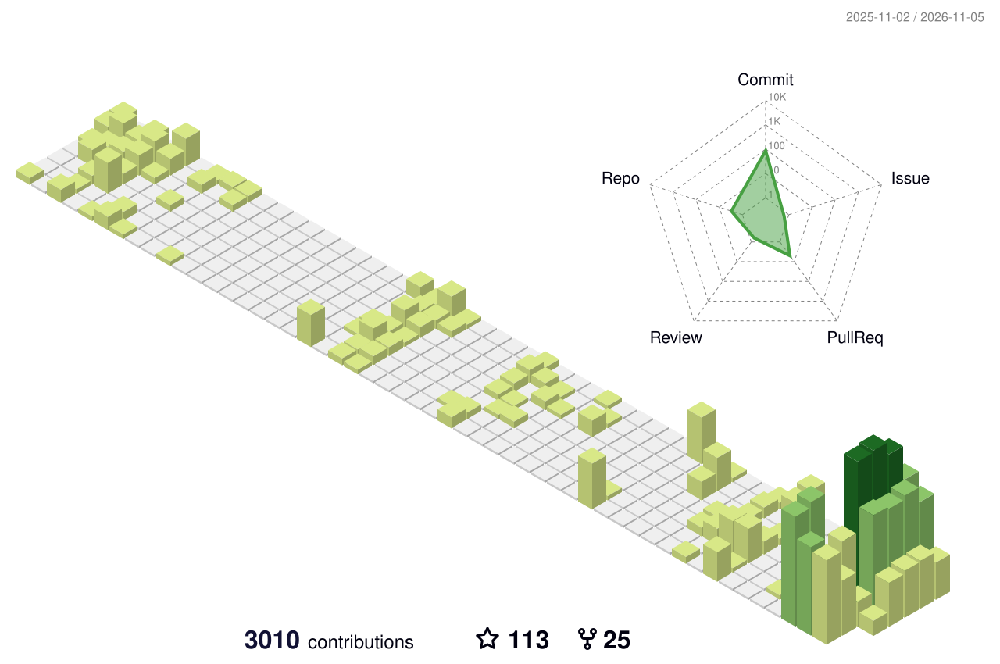

<picture>
  <source media="(prefers-color-scheme: dark)" srcset="profile-3d-contrib/profile-night-rainbow.svg">
  
</picture>

I build things that move, and the software that drives them. Lately that's autonomous RC trucks, a voice-controlled claw, a Roblox fighting game, and a split-flap display that's still on the bench.

<samp><a href="https://github.com/pyturtle?tab=repositories">repositories</a> · <a href="https://www.youtube.com/@Smi1eM3">youtube</a> · portfolio, soon</samp>

#### Robotics & hardware

- **[Pursuit Swarm](https://github.com/pyturtle/ProjectAMPM)**: two used Traxxas trucks that corner a target on their own, with tag localization, person re-ID, Hybrid A\* planning and a QNX node that can stop everything. Best Use of QNX at Hack the 6ix 2026.
- **[DeskClaw](https://github.com/taliamekh/DeskClaw)**: say "Hey Claw" and an overhead camera finds the object, A\* plans a path, and a rover drives over to pick it up. I built the vision and planning. Best GenAI Hardware Hack at GenAI Genesis 2026.
- **Split-flap display**: a mechanical departures board, one flap module at a time. On the bench now.
- **FRC**: team lead for two seasons. Trained 15 new members and ran a 20-person sub-team through competition.

#### Software

- **[JobApps](https://github.com/pyturtle/jobapps)**: a self-hosted application assistant. It picks postings that fit, drafts grounded answers with Claude and fills the forms; I review and press submit.
- **[Valorant AI](https://github.com/pyturtle/Valorant-AI-cheats)**: code for my 24-video YOLOv5 course (100k+ viewers). About 4,000 labelled images, and TensorRT for 40% faster inference.
- **Humanoid teams**: multi-agent RL research. Simulated humanoid teams trained with PPO and MAPPO in NVIDIA Isaac Lab.
- **A Roblox platform fighter**: server-run matches with client prediction and rollback, bots up to Grandmaster, and a frame-stepping training mode. In playtesting.

#### Off the keyboard

FPV quads, an Ender 3 that turned into a Bambu P1S, two split keyboards running QMK and ZMK, and a smart mirror I built as a kid.

Archive, 2019–2025

- **2025**: [NorthStar](https://github.com/pyturtle/NorthStarSpurHacks), safety-first navigation for the GTA (SpurHacks) · a hands-free car assistant (Twilio, faster-whisper, Piper) · keymaps for my split keyboards
- **2023–24**: a React Native + Bluetooth field app at my first dev job, used by 250+ contractors · two FRC seasons · started CS at university
- **2022**: [Delecive](https://github.com/pyturtle/DeleciveSnap), visual clothing search with object detection, and VBall Trainer, a pose-tracking volleyball coach (both at hack::peel) · [Elden Ring of Text](https://github.com/pyturtle/elden_ring_of_text), a text RPG
- **2021**: Reddit API bots · the CCC
- **2020**: my first repo, a screen-reading bot built on OpenCV and Tesseract
- **2019**: started teaching a kids' robotics class

